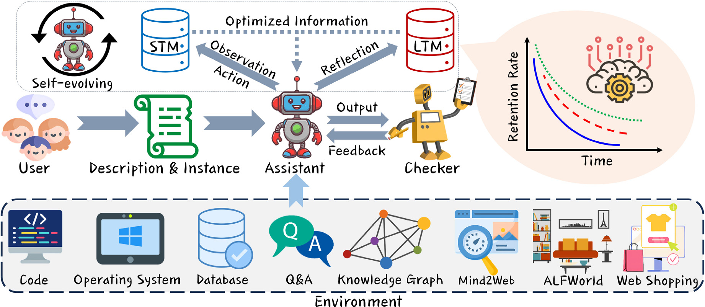
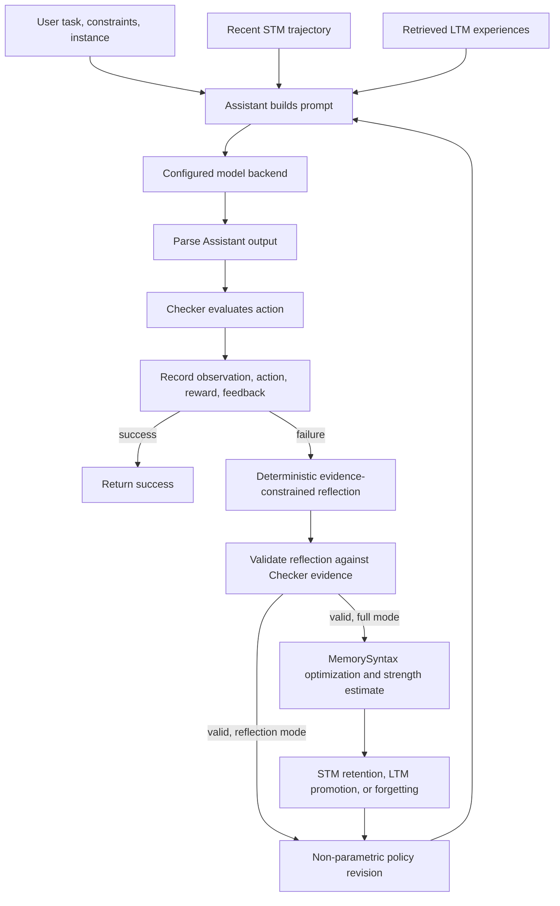
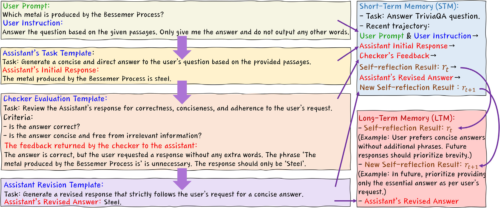
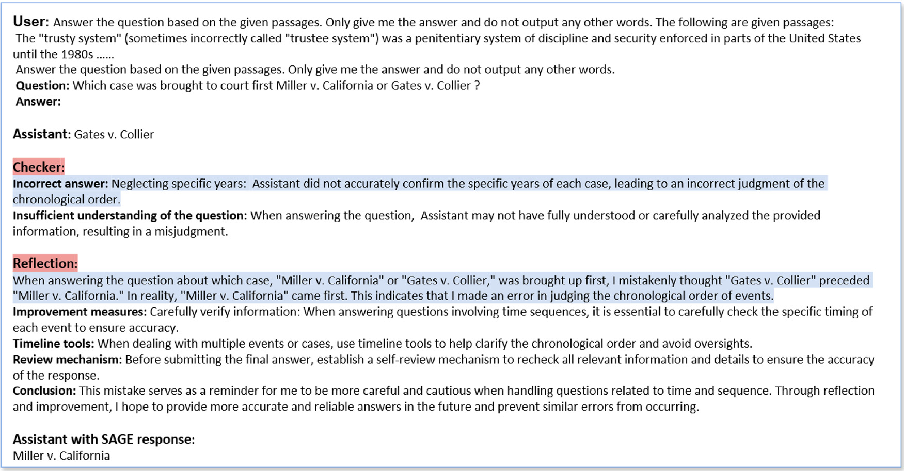
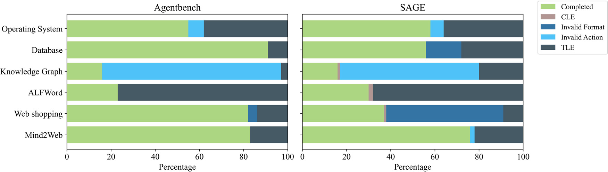

# SAGE: Self-evolving Agents with Reflective and Memory-augmented Abilities

## 1. Paper Information

- **Paper:** Xuechen Liang et al., “SAGE: Self-evolving Agents with Reflective and Memory-augmented Abilities”
- **Venue:** *Neurocomputing*, 647 (2025), article 130470
- **DOI:** [10.1016/j.neucom.2025.130470](https://doi.org/10.1016/j.neucom.2025.130470)

## 2. Overview

SAGE studies how an agent can improve its behavior during interaction by using checker feedback, reflection, and structured memory, without requiring policy-weight fine-tuning. The motivation includes several practical limitations of long-running LLM agents:

- useful information may be forgotten between interactions;
- repeatedly keeping full conversation histories increases context and inference costs;
- failures may recur when feedback is not converted into an actionable correction;
- unfiltered memory can retain redundant or low-value content;
- an agent needs a way to adapt its prompts and plans without retraining model weights.

This project implements those method components with small local tasks. A task run is auditable: prompts, parsed outputs, Checker results, policy revisions, reflection objects, model-call metadata, and memory events are recorded in JSON when an output path is supplied.

## 3. SAGE Architecture

<p align="center">
  
</p>
<p align="center"><em>Figure 1. Overview of the SAGE architecture from the original paper.</em></p>
<p align="center"><sub>Source: Liang et al., “SAGE: Self-evolving Agents with Reflective and Memory-augmented Abilities,” <em>Neurocomputing</em> 647 (2025), 130470, PDF page 3 (printed page 3). <a href="https://doi.org/10.1016/j.neucom.2025.130470">https://doi.org/10.1016/j.neucom.2025.130470</a>. Copyright © 2025 Elsevier B.V.</sub></p>

The diagram shows the full-mode execution order implemented here. A failed action is recorded before reflection and memory processing; retrieved memories are available to the next Assistant call.



The User supplies a task and constraints. The Assistant constructs an action from the current task, previous feedback, recent STM, and relevant LTM. The Checker evaluates the action in a task environment. On failure, the trajectory informs a structured reflection and a revised next-step policy. In full mode, the validated reflection is optimized and managed by STM/LTM. The agent stops on Checker success or after the configured iteration limit.

## 4. Core Methodology

### Roles

- **User:** supplies the task, instance, and constraints.
- **Assistant:** calls the selected text-generation backend and returns a task action, such as a structured answer or SQL query.
- **Checker:** executes task-specific validation and returns success, score/reward, evidence references, and actionable errors.

The Checker is not a language-model judge. QA uses normalized answer matching and required evidence passage IDs. SQL uses a real SQLite database and compares returned columns and rows against the task expectation.

### Iterative Feedback

Each iteration reads only state already available before generation: the task, earlier rewards and Checker feedback, recent trajectory, retrieved memories, and any existing policy revision. The current Checker result is attached after the Assistant has generated its action. A failed Checker result becomes explicit correction instructions for the next call. Success stops the loop early; exhausting `--max-iterations` returns a failure status.

<p align="center">
  
</p>
<p align="center"><em>Figure 2. Iterative feedback and reflection workflow from the original paper.</em></p>
<p align="center"><sub>Source: Liang et al., “SAGE: Self-evolving Agents with Reflective and Memory-augmented Abilities,” <em>Neurocomputing</em> 647 (2025), 130470, PDF page 4 (printed page 4). <a href="https://doi.org/10.1016/j.neucom.2025.130470">https://doi.org/10.1016/j.neucom.2025.130470</a>. Copyright © 2025 Elsevier B.V.</sub></p>

The paper's workflow illustration connects the user prompt, Assistant generation, Checker evaluation and feedback, revision, and the STM/LTM reflection context.

### Self-Evolution

The paper leaves the update operator open. This implementation represents the memory and adaptation objectives as `EvolutionGoal` and records a `PolicyRevision` with its version, prior version, revised instructions, corrective plan, selected memories, and originating feedback ID. This is non-parametric adaptation: prompts, plans, and memory context change; model weights do not.

### Reflection

`ReflectionGenerator` turns task context, Assistant outputs, Checker feedback, reward history, recent trajectory, and retrieved experiences into a structured reflection. It records the error, root cause, failed decision, correction, next action, reusable lesson, task category, evidence references, and source feedback ID. `ReflectionValidator` checks schema, provenance, evidence, confidence bounds, and agreement with Checker errors. A reflection that fails validation is not stored.

The reflection generator is deterministic and evidence-constrained. **Reflection is not generated by an LLM in this project.** It is an engineering realization of the paper’s abstract reflection function.

### Reflection Example from the Paper

The paper's HotpotQA example shows an initial answer of "Gates v. Collier" rejected by the Checker because the chronology was not verified. The reflection identifies the mistaken ordering and recommends checking the event dates; the revised answer is "Miller v. California." This is the paper's illustrative example, not a model output from this reproduction.

<p align="center">
  
</p>
<p align="center"><em>Figure 3. HotpotQA reflection example reported in the original paper.</em></p>
<p align="center"><sub>Source: Liang et al., “SAGE: Self-evolving Agents with Reflective and Memory-augmented Abilities,” <em>Neurocomputing</em> 647 (2025), 130470, PDF page 4 (printed page 4). <a href="https://doi.org/10.1016/j.neucom.2025.130470">https://doi.org/10.1016/j.neucom.2025.130470</a>. Copyright © 2025 Elsevier B.V.</sub></p>
<p align="center"><sub>Third-party text within Figure 3: the opening “trusty system” passage is reproduced in the paper figure from Wikipedia contributors, <a href="https://en.wikipedia.org/wiki/Trusty_system_(prison)">“Trusty system (prison)”</a>, under <a href="https://creativecommons.org/licenses/by-sa/4.0/">CC BY-SA 4.0</a>. The passage is unchanged in the figure; this attribution applies to that excerpt only.</sub></p>

## 5. Mathematical Formulation

The equations below restate the method described in the paper. Implementation-specific choices are identified separately in [Engineering Assumptions](docs/ENGINEERING_ASSUMPTIONS.md) and [Equation Audit](docs/EQUATION_AUDIT.md).

### Eq. 1 — Iterative Feedback

$$
o_t \sim \pi_\theta(o_t \mid s_t, R_t, f_t^i)
$$

Here $o_t$ is the Assistant action, $s_t$ is the task/environment state, $R_t$ is a reward-related signal, and $f_t^i$ is Checker feedback. The paper’s notation does not fully specify the timing of the feedback. For causal consistency, this implementation supplies only **prior** feedback and rewards when building the current prompt; the current Checker score is produced afterward.

### Eqs. 2–3 — Self-Evolution

$$
G_{t+1} = (A_{t+1}, D_{t+1})
$$

$$
\pi_{\theta,t+1} = \psi(\pi_{\theta,t}, G_{t+1})
$$

$A_{t+1}$ denotes a memory-related objective and $D_{t+1}$ an adaptation objective. The implementation records these objectives and uses feedback to revise prompts, plans, and retrieved context. The paper does not require a particular optimizer or model-weight update; this project does not perform gradient updates.

### Eqs. 4–5 — Reflection and Long-Term Memory

$$
r_t = \mathrm{ref}(o_{1:t}, R_{1:t})
$$

$$
M_L \leftarrow M_L \cup \{r_t\}
$$

The reflection is derived from the interaction history and Checker evidence. In full mode, a validated reflection is optimized and admitted to the memory lifecycle; only memories that survive retention management remain searchable.

### Eq. 6 — Ebbinghaus Forgetting Curve

$$
R(I_t, \tau) = \exp(-\tau / S)
$$

$\tau \ge 0$ is elapsed time in the configured unit, $S > 0$ is memory strength, and $R \in [0,1]$ is retention. At $\tau=0$, $R=1$. The implementation supports seconds, minutes, hours, and days, with `SystemClock` and injectable `FakeClock`.

### Eq. 7 — MemorySyntax

MemorySyntax transforms information $I_t$ into a linguistically optimized representation $I_t^{&#42;}$ while retaining the source information. The implementation stores both the original and optimized information, base strength $S$, optimized strength $S^{&#42;}$, memory layer, active strength, and current retention. Its layer-dependent retention branch is:

$$
R(I_t^{&#42;}, \tau) =
\begin{cases}
\exp\left(-\dfrac{\tau}{S^{&#42;}}\right),
& \text{if } I_t^{&#42;} \in \mathcal{M}_{S}, \\\\[6pt]
\exp\left(-\dfrac{\tau}{S}\right),
& \text{if } I_t^{&#42;} \in \mathcal{M}_{L}.
\end{cases}
$$

The optimizer extracts salient facts, entities, constraints, Checker errors, causes, corrections, reusable lessons, and evidence references; removes duplicate expressions; and checks that protected information survives. Strength estimation is an explicit engineering assumption because the paper does not give a unique estimator.

### Eq. 8 — Retention Thresholds

This project follows the paper’s prose description of three states using $\theta_1=0.7$ and $\theta_2=0.3$:

$$
\text{state}(R) =
\begin{cases}
\mathrm{STM} & R \ge 0.7 \\
\mathrm{LTM} & 0.3 \le R < 0.7 \\
\mathrm{FORGOTTEN} & R < 0.3
\end{cases}
$$

The paper’s Eq. 8 expression and prose do not specify the transition in exactly the same way. This implementation uses the prose’s three-state interpretation; the boundary decisions are tested and documented in [Equation Audit](docs/EQUATION_AUDIT.md).

## 6. MemorySyntax and Memory Lifecycle

A memory record preserves:

- original information $I$ and optimized information $I^{&#42;}$;
- base and optimized strengths $S$ and $S^{&#42;}$;
- the active STM/LTM layer, current strength, retention, timestamps, and reinforcement count;
- a structured reflection and evidence references.

The optimizer is linguistic and content-aware, not a string truncation step. It extracts task constraints, key entities, facts, failure causes, successful corrections, and evidence; de-duplicates repeated wording; and verifies important content before allowing a strength increase. Token counts are a portable **lexical token estimate**, not counts from the Qwen tokenizer.

### StrengthEstimator

The implementation uses a normalized, weighted salience estimate based on Checker quality, constraint importance, task importance, reflection reusability, evidence count, and prior reuse. It maps that score to an equivalent decay-resistance duration between 60 and 3600 seconds, converted to the configured unit. The weights and mapping range are engineering assumptions, not constants provided by the paper. On STM-to-LTM promotion, the LTM decay epoch starts at promotion and uses base $S$.

### Forgetting and Reinforcement

At each lifecycle tick, retention is computed and a state transition is applied. Records below the lower threshold are removed from searchable storage. Re-access restores active retention at the current time and reinforces strength/access count. The process and boundary rules are independently testable using `FakeClock` without waiting in real time.

The verified MemorySyntax demonstration computed $R(30,60)=0.6065306597$. Its lexical estimate changed from 177 to 93 (84 fewer estimated tokens) while retaining the protected fact and constraint. This small local demonstration is not the paper’s reported memory-overhead result.

## 7. Implementation Details

- **Backends:** `MockBackend` for deterministic tests, `LocalModelBackend` for GGUF inference through `llama-cpp-python`, and `OpenAICompatibleBackend` for an explicitly configured compatible endpoint.
- **Failure behavior:** a missing model, backend error, or unparsable output is recorded. A failed real backend does not silently fall back to Mock.
- **Memory:** STM is bounded in process; SQLite stores persistent LTM and timestamped reflection memories. Retrieval uses lightweight lexical overlap and a task-type bonus; no embedding service is required.
- **SQL safety:** each query uses a SQLite `mode=ro` connection and an authorizer restricted to read operations. The SQL environment uses only a generated local demo database.
- **Evaluation:** `base` runs the Checker without reflection or MemorySyntax; `reflection` adds Checker-driven reflection and policy changes; `full` also adds STM/LTM and MemorySyntax. Small comparisons are functional smoke evaluations, not benchmark replications.

## 8. Paper-to-Code Mapping

| Paper component | Paper reference | Implementation | Validation evidence |
| --- | --- | --- | --- |
| User, Assistant, Checker | Section 3.1 | `src/sage/agents/user.py`, `src/sage/agents/assistant.py`, `src/sage/feedback/checker.py` | `tests/unit/test_reflection_agent.py`, integration tests |
| Iterative feedback | Eq. 1 | `src/sage/agents/agent.py` | Tests verify earlier feedback is present in the next actual backend input |
| Evolution objective and policy revision | Eqs. 2–3 | `src/sage/core/types.py`, `src/sage/agents/agent.py` | Versioned policy state and changed corrective prompt are tested |
| Reflection and insertion | Eqs. 4–5 | `src/sage/reflection/generator.py`, `schema.py`, `validator.py` | Structured reflection validation and memory insertion tests |
| STM and LTM | Section 3.2 | `src/sage/memory/store.py`, `manager.py` | Capacity, persistence, retrieval, reinforcement, migration, and deletion tests |
| MemorySyntax and strength | Eq. 7 | `src/sage/memory/syntax.py`, `src/sage/core/types.py` | Content preservation, compression proxy, and strength tests |
| Ebbinghaus retention | Eq. 6 | `src/sage/memory/forgetting.py`, `src/sage/core/clock.py` | Numerical, monotonicity, invalid-input, and fake-clock tests |
| Threshold lifecycle | Eq. 8 | `src/sage/memory/manager.py` | Boundary and real lifecycle-operation tests |
| QA and SQLite Checker | Section 3.1 | `src/sage/environments/qa.py`, `src/sage/environments/sql.py` | QA evidence checks, SQL execution, and unsafe-query rejection |
| Backends and CLI | Engineering implementation | `src/sage/backends/`, `src/sage/cli.py` | CLI integration tests and recorded local model validation |

See [docs/PAPER_TO_CODE.md](docs/PAPER_TO_CODE.md) for the expanded mapping and execution sequence.

## 9. Repository Structure

```text
src/sage/       Agent roles, backends, reflection, memory, tasks, CLI
configs/        Default and local-model example configuration
examples/       Small task fixture; SQL database is generated on demand
scripts/        Optional real-trace validation utilities
tests/          Unit and integration tests
docs/           Equation audit, assumptions, mapping, validation report
```

The demo SQLite database is generated on demand and is not committed. Model weights, runtime outputs, and private traces are not part of the repository.

## 10. Installation

### Windows PowerShell (tested on Python 3.13.5, 64-bit)

```powershell
git clone https://github.com/Kevin3777/SAGE-Paper-Reproduction.git
Set-Location SAGE-Paper-Reproduction
python --version
python -m venv .venv
.\.venv\Scripts\python.exe -m pip install --upgrade pip
.\.venv\Scripts\python.exe -m pip install -e ".[test]"
.\.venv\Scripts\python.exe -m pytest -q
.\.venv\Scripts\python.exe -m sage.cli --help
```

The package declares Python `>=3.10`; the recorded project validation used Python 3.13.5. The Windows test environment used a separate project-local virtual environment.

### Linux and macOS (not tested in this project environment)

```bash
git clone https://github.com/Kevin3777/SAGE-Paper-Reproduction.git
cd SAGE-Paper-Reproduction
python3 -m venv .venv
. .venv/bin/activate
python -m pip install --upgrade pip
python -m pip install -e ".[test]"
python -m pytest -q
python -m sage.cli --help
```

SQLite and Mock workflows use the Python standard library. The optional `llama-cpp-python` backend depends on platform-compatible wheels or a working C++ build toolchain; installation and inference have not been validated on Linux/macOS in this project.

## 11. Model Preparation

No model weights are included. The verified model family is [Qwen2.5-1.5B-Instruct-GGUF](https://huggingface.co/Qwen/Qwen2.5-1.5B-Instruct-GGUF), which provides the `Q4_K_M` file used in validation. The model repository lists an Apache-2.0 license; review the model card and license for the exact artifact and any applicable terms before downloading or using it. Model license and code license are separate.

Place a compatible GGUF wherever you have storage, then pass its local path to `--model-path`. For the CPU wheel used by the Windows validation environment:

```powershell
.\.venv\Scripts\python.exe -m pip install --only-binary=:all: llama-cpp-python --extra-index-url https://abetlen.github.io/llama-cpp-python/whl/cpu
```

The optional package can require platform-specific wheels or C++ build tools. The validation run used CPU inference. GPU/CUDA llama.cpp builds are optional and unverified here.

## 12. Configuration

`configs/default.yaml` is a portable Mock-first configuration. `configs/local.example.yaml` shows the local GGUF settings. Neither contains an author-specific machine path. Copy the local example to a private file if you want to customize it, or override the model with `--model-path`.

The compatible API backend is opt-in. Configure `SAGE_API_BASE_URL` and `SAGE_API_MODEL`, and `SAGE_API_KEY` only when your endpoint requires a key. Do not place keys in YAML or commit `.env` files. The project makes no API request unless `--backend openai-compatible` is explicitly selected.

## 13. Quick Start

Run from the repository root after installation:

```powershell
.\.venv\Scripts\python.exe -m sage.cli env
.\.venv\Scripts\python.exe -m sage.cli memory-demo --out outputs\memory_demo.json
.\.venv\Scripts\python.exe -m sage.cli run --backend mock --mode full --task qa --max-iterations 3 --out outputs\mock_qa.json
```

Mock output is deterministic test output; it is not model inference.

## 14. Running SAGE Agents

All three modes use the same task and Checker. The Mock backend deliberately starts with an incorrect action so feedback behavior can be observed.

```powershell
# Baseline: Checker, no reflection or MemorySyntax
.\.venv\Scripts\python.exe -m sage.cli run --backend mock --mode base --task qa --max-iterations 3 --out outputs\base_qa.json

# Checker feedback, deterministic reflection, and prompt/plan revision
.\.venv\Scripts\python.exe -m sage.cli run --backend mock --mode reflection --task qa --max-iterations 3 --out outputs\reflection_qa.json

# Full: feedback, reflection, STM/LTM, and MemorySyntax
.\.venv\Scripts\python.exe -m sage.cli run --backend mock --mode full --task qa --max-iterations 3 --out outputs\full_qa.json

# SQLite task: multi-table join, active-employee filter, and Checker validation
.\.venv\Scripts\python.exe -m sage.cli run --backend mock --mode full --task sql --max-iterations 3 --out outputs\mock_sql.json
```

To run the actual local model, substitute the path to your downloaded GGUF:

```powershell
.\.venv\Scripts\python.exe -m sage.cli run --backend local --model-path "<path-to-your-model.gguf>" --config configs\local.example.yaml --mode full --task qa --max-iterations 3 --out outputs\local_qa.json
```

A model load error is reported as a real backend failure; the system does not change to Mock automatically. The local backend’s log records its model identifier, generation settings, call status, latency, token counts when supplied by the backend, and any error.

## 15. Memory Lifecycle Demonstration

```powershell
.\.venv\Scripts\python.exe -m sage.cli memory-demo --out outputs\memory_demo.json
.\.venv\Scripts\python.exe -m sage.cli inspect-memory --out outputs\memory_inspection.json
```

`memory-demo` uses a virtual clock to show numeric retention, optimization checks, threshold boundaries, STM-to-LTM promotion, and deletion. Running QA/SQL in `full` mode also writes and retrieves runtime memories in the configured SQLite database. `inspect-memory` reports active persisted records; generated `outputs/` files and databases are ignored by Git.

## 16. Evaluation Modes

The small deterministic comparison runs the same QA and SQL task families through all three modes:

```powershell
.\.venv\Scripts\python.exe -m sage.cli evaluate --backend mock --task all --max-iterations 3 --out outputs\evaluation.json
```

The output reports success, iterations, Checker calls, reflections, memory reads/writes/migrations/deletions, token usage, and runtime. These are functional examples on hand-authored tasks; they do not estimate paper-scale performance.

## 17. Reproduction Validation

The source project was validated with **48 passing tests**. A local Qwen2.5-1.5B-Instruct Q4_K_M GGUF run on CPU produced “Wellington” with required evidence and passed the Checker in one call. In a separate disclosed controlled-input run, the real model repeatedly cited only p2 despite feedback requiring p1 and p2; it reached the iteration limit and failed. A later process retrieved the persisted evidence-grounded experiences and passed the corresponding task. A further local run retrieved an LTM reflection and passed QA. These outcomes are reported separately; the failed run is not represented as successful same-task correction.

The evidence and limits are summarized in [docs/VALIDATION_REPORT.md](docs/VALIDATION_REPORT.md). The published repository contains no raw runtime logs; the above are historical validation results from the local development environment. Re-running tests from a clone validates the packaged source and Mock workflows, not the author’s model run.

### Results Reported in the Original Paper

The following chart is the original paper's Figure 4: AgentBench execution results across six tasks. It is source-paper evidence only; it was not generated by this repository. This reproduction reports 48 automated tests and small local LLM task checks, and did not rerun AgentBench or reproduce the chart's benchmark results.

<p align="center">
  
</p>
<p align="center"><em>Figure 4. AgentBench execution results across six tasks, reported in the original paper.</em></p>
<p align="center"><sub>Source: Liang et al., “SAGE: Self-evolving Agents with Reflective and Memory-augmented Abilities,” <em>Neurocomputing</em> 647 (2025), 130470, PDF page 7 (printed page 7). <a href="https://doi.org/10.1016/j.neucom.2025.130470">https://doi.org/10.1016/j.neucom.2025.130470</a>. Copyright © 2025 Elsevier B.V.</sub></p>

## 18. Engineering Assumptions

The paper does not uniquely define the policy-update operator, reflection schema, information optimizer, strength estimator, time unit, or how optimized strength carries into LTM. This project makes those choices explicit: deterministic evidence-constrained reflection; non-parametric prompt and plan revisions; lexical overlap retrieval; weighted salience mapped to a duration; and a new base-strength decay epoch after promotion. See [docs/ENGINEERING_ASSUMPTIONS.md](docs/ENGINEERING_ASSUMPTIONS.md) and [docs/EQUATION_AUDIT.md](docs/EQUATION_AUDIT.md).

## 19. Limitations

- This is an independent core-method implementation, not an official release or a full reproduction of the paper’s experiments.
- It does not include training, fine-tuning, original AgentBench/HotpotQA/TriviaQA evaluation, or reported accuracy, F1, throughput, or memory-overhead gains.
- Tasks and data are small, hand-authored functional fixtures. The SQL Checker checks one fixed demonstration result.
- Reflection is deterministic rather than model-generated; memory retrieval uses lexical overlap rather than a learned embedding index.
- Real inference was verified on CPU with one small quantized model. CUDA inference and other operating systems are unverified.
- Token reduction values are lexical estimates, not tokenizer measurements.

## 20. Citation

If this implementation is useful, cite the paper:

> Liang, X. et al. (2025). SAGE: Self-evolving Agents with Reflective and Memory-augmented Abilities. *Neurocomputing*, 647, 130470. https://doi.org/10.1016/j.neucom.2025.130470

## 21. Acknowledgments and Licensing

The method is based on the cited paper. The four original paper figures are reproduced by a co-author for scholarly presentation under the publisher's author reuse rights and are not covered by any software license applicable to this repository. Further reuse may require permission from the relevant rights holder. The verified GGUF model is distributed separately by its publisher; consult the model card and license before use. The paper PDF, model weights, and benchmark datasets are not included.

No software license has been selected for this reproduction yet. Until a `LICENSE` file is added by the copyright holder, the repository code remains under default copyright restrictions; public visibility alone does not grant reuse rights. Maintainers should confirm ownership and choose a code license before describing the repository as open source.
